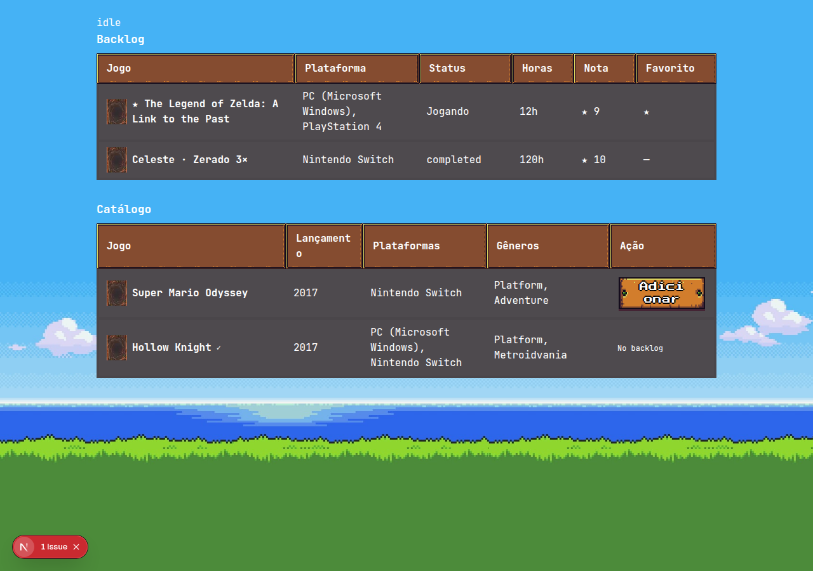
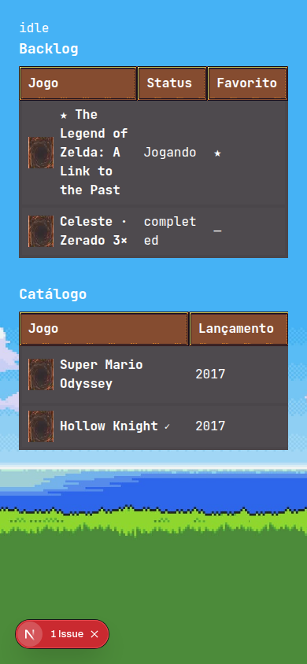
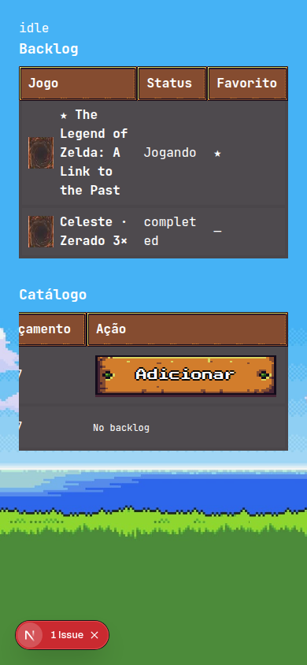

# Relatório — refatoração para tabelas HTML semânticas

## 1. Diagnóstico da implementação antiga

As visualizações compartilhadas de backlog/coleções e catálogo simulavam tabelas com linhas e células em CSS Grid. Cabeçalho e corpo eram layouts independentes, então as proporções e larguras podiam divergir. A composição do menu de contexto também envolvia seus filhos em um `
`, incompatível como filho direto de `<tbody>`.

As linhas já abriam os detalhes por clique; a refatoração preservou esse fluxo e acrescentou ativação por teclado, sem manter a ação redundante de detalhes no backlog.

## 2. Estrutura HTML adotada

A infraestrutura compartilhada agora renderiza `<table>`, `<colgroup>` (nos cabeçalhos específicos), `<thead>`, `<tbody>`, `<tr>`, `<th scope="col">` e `<td>` nativos. O navegador resolve uma única geometria de colunas para cabeçalho e corpo. As tabelas ficam em wrappers `overflow-x-auto`, têm largura mínima por contexto e permitem quebra natural de texto e altura variável.

O backlog/coleções tem seis colunas: Jogo, Plataforma, Status, Horas, Nota e Favorito. O catálogo mantém Jogo, Lançamento, Plataformas, Gêneros e Ação.

## 3. Arquivos alterados

- `features/games/data-table.tsx` — componentes compartilhados com semântica nativa e ativação de linha.
- `features/games/backlog-table-row.tsx` — cabeçalho/linha do backlog, colunas e larguras.
- `features/atp/catalog-table-row.tsx` — cabeçalho/linha do catálogo e ação de importação.
- `features/games/context-menu.tsx`, `features/games/game-context-menu.tsx`, `features/atp/catalog-context-menu.tsx` — suporte ao gatilho sem wrapper.
- `features/games/backlog-view.tsx`, `features/atp/catalog-search.tsx` — ativação do modo sem wrapper apenas nas tabelas.
- `app/globals.css` — molduras RPGUI aplicadas a elementos de tabela.
- `tests/games/data-table.test.ts`, `tests/games/backlog-table-row.test.tsx`, `tests/games/context-menu-aschild.test.tsx` — contratos estruturais e de interação.
- `docs/semantic-table-validation/` — capturas de validação e medições do navegador.

As alterações não relacionadas da tarefa anterior de tipografia de navegação e seu relatório foram preservadas.

## 4. Integração com RPGUI

O cabeçalho usa a arte dourada vendorizada e as células do corpo usam o fundo cinza, com bordas, cores e tipografia RPGUI. Hover e foco visível são aplicados diretamente às células da linha. Nenhum container RPGUI que injete `
` foi colocado dentro da tabela. Capas, favorito e nota permanecem visíveis.

## 5. Adaptação dos menus de contexto

`CustomContextMenu` agora aceita `asChild`: clona o único filho e anexa o manipulador de contexto diretamente à linha. Os consumidores de grid/lista mantêm o wrapper anterior; somente backlog e tabela do catálogo usam `asChild`. O menu continua em portal e seus itens foram exercitados no navegador.

## 6. Acessibilidade

- Cabeçalhos usam `<th scope="col">`; dados usam `<td>`.
- Linhas acionáveis recebem `tabIndex=0` e abrem detalhes por clique, Enter e Espaço.
- O foco tem realce visível nas células.
- A ação interna de importação interrompe a propagação e não abre detalhes.
- Não há botão envolvendo `<tr>` nem `
` diretamente sob `<tbody>`.
- Nenhuma semântica tabular é simulada por roles ARIA.

## 7. Comportamento em desktop/mobile

No desktop, todas as colunas ficam visíveis e não há scroll horizontal. No mobile, o backlog mantém Jogo, Status e Favorito sem scroll; as demais colunas ficam ocultas responsivamente. O catálogo preserva Jogo, Lançamento e Ação na área inicial, mantendo Plataformas e Gêneros disponíveis na tabela rolável horizontalmente.

Títulos, plataformas e outros textos podem ocupar várias linhas. A verificação no navegador não encontrou overflow horizontal de conteúdo dentro das células amostradas.

## 8. Testes automatizados

- TypeScript (`pnpm typecheck`): aprovado.
- Testes direcionados (games, navigation, collections e atp): 21 arquivos, 327 testes aprovados.
- Suíte completa (`pnpm test`): 121 arquivos, 1.432 testes aprovados.
- ESLint (`pnpm lint`): zero erros; sete avisos, incluindo um aviso de dependências de hook em `catalog-search.tsx` e seis diretivas eslint obsoletas em script preexistente.
- Build de produção (`pnpm build`): aprovado.

## 9. Validação visual e medições

Foi criada temporariamente uma rota de validação com os componentes reais de backlog e catálogo, menu de contexto e dados representativos; a rota e os scripts auxiliares foram removidos ao final. As capturas foram feitas em Chrome a 1280×900 e 390×844. Medições completas estão em `docs/semantic-table-validation/measurements.json`.

- Desktop: backlog 6/6 e catálogo 5/5 colunas; em cada coluna visível, diferença de posição e largura entre `<th>` e `<td>` = **0 px**.
- Mobile: colunas visíveis também tiveram diferença = **0 px**; colunas responsivamente ocultas foram excluídas da comparação.
- Backlog mobile: wrapper 342 px de largura e tabela 342 px; sem scroll.
- Catálogo mobile: wrapper 342 px e tabela 600 px; scroll horizontal presente.
- Títulos/plataformas da amostra quebraram em até três linhas; nenhuma célula amostrada excedeu seu `scrollWidth`.
- Clique, Enter e Espaço abriram detalhes; a ação Adicionar atualizou o estado de importação sem abrir detalhes; o menu de contexto abriu corretamente.
- Backlog não tem coluna Ações/Detalhes; catálogo mantém Ação/Adicionar.

Capturas:

## 10. Código obsoleto removido

Foram removidos os templates `BACKLOG_TABLE_GRID` e `CATALOG_TABLE_GRID`, os layouts de grid das tabelas e o estilo antigo de geometria da moldura. Não há implementação paralela de tabela. O wrapper de menu continua disponível para consumidores não tabulares.

## 11. Riscos remanescentes

- O build reporta a inferência de raiz do workspace devido a múltiplos lockfiles; não foi alterada configuração fora do escopo.
- Permanecem os avisos de ESLint descritos acima; não impedem o build.
- A validação visual usou componentes reais com dados controlados, não uma sessão autenticada com dados de produção.

## 12. Veredito final

**Concluído.** Backlog/coleções e catálogo utilizam tabelas HTML semânticas; cabeçalho e corpo compartilham a geometria nativa do browser; wrapping, responsividade, interações, acessibilidade e identidade RPGUI foram verificados. TypeScript, suíte completa e build passaram. Nenhum commit ou push foi realizado.
